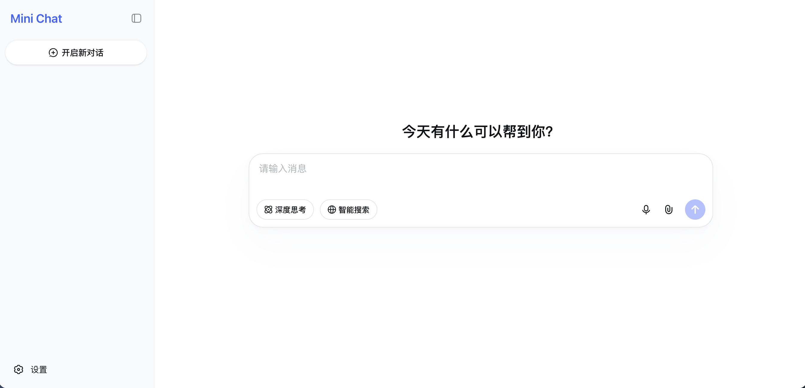

# Mini Chat

English | [简体中文](README.zh-CN.md)

A static chat app powered by the DeepSeek API. No application backend is required: the browser connects directly to the configured API service, and all data stays local.



This repo is a personal fork and reading/learning project based on the official [deepseek-ai/chat-demo](https://github.com/deepseek-ai/chat-demo). The UI strings, page title, and documentation have been adjusted for this fork; the architecture notes live in [SOURCE_GUIDE.md](SOURCE_GUIDE.md) (Chinese).

## Getting started

Install Node.js 22.12+ and pnpm, then run:

```sh
git clone https://github.com/Hiohk/mini-chat.git
cd mini-chat
pnpm install
pnpm dev
```

Open http://localhost:8090. Enter your API key in Settings before your first chat.

To build the static site:

```sh
pnpm build
```

The output is written to `dist/`. Serve it from any static web server, or open `dist/index.html` directly — the latter requires browser support for storage on `file://` pages and an API service that permits such cross-origin requests.

## Features

- Multiple conversations with automatic titles, renaming, and deletion; edit prompts, regenerate replies, and switch between message branches.
- Streaming replies, deep thinking, smart search, link reading, and source citations; stop generation or continue eligible replies.
- Upload, paste, or drag and drop attachments; voice input and read-aloud replies. A live audio spectrum appears in the first row of the input area while recording on mobile.
- Markdown, syntax highlighting, KaTeX math, and Mermaid diagrams.
- Simplified Chinese and English, light and dark themes, mobile layouts, location settings, and chat history import and export.

## Data and storage

Your API key and settings are stored in the browser's localStorage. Conversations and original attachments are stored in IndexedDB. Local data is isolated by browser profile and site origin. Sending messages, uploading attachments, and using speech features sends the relevant content to the configured API service.

History import and export in Settings use ZIP archives. After confirmation and successful validation, importing replaces all local conversations and attachments. Exports include conversations and locally available original images, but exclude API keys, settings, and original non-image attachments. See the [history import/export documentation (Chinese)](src/services/chat/history/README.md) for the archive format and preservation details.

Settings → Data → Delete all chats clears all local conversations, original attachments, and unsent drafts after confirmation. It stops ongoing replies and returns to a new chat. Your API key and settings are preserved; files already uploaded to the API service are not deleted.

## Development

| Command       | Description                  |
| ------------- | ---------------------------- |
| `pnpm dev`    | Start the development server |
| `pnpm build`  | Build into `dist/`           |
| `pnpm type`   | Run TypeScript type checks   |
| `pnpm lint`   | Lint with oxlint             |
| `pnpm format` | Format with oxfmt            |

[rspack.config.ts](rspack.config.ts) uses `https://api.deepseek.com` by default. Use `createConfig({ apiOrigin, devServer })` to customize the API origin and development server proxy.

Chat uses `deepseek-flash` by default through Anthropic-compatible Messages / Files APIs. Speech features use ASR / TTS endpoints. Requests include extensions for search, link reading, titles, and `latest_reminder`, so the configured service must support the corresponding capabilities. Supported attachment formats are determined by server-side validation.

```text
src/
  app/                 Application layout, themes, and global styles
  components/          Chat, settings, Markdown, and other UI components
  i18n/                English and Chinese translations
  services/
    api/               API requests, SSE, and protocol types
    chat/              Conversations, message branches, storage, and history import/export
    markdown/          Markdown parsing, syntax highlighting, and diagrams
    speech/            Audio recording and read-aloud playback
  utils/               Shared utilities
```

For a per-module walkthrough of the architecture, see [SOURCE_GUIDE.md](SOURCE_GUIDE.md).

## Credits and license

Originally created by the DeepSeek team as [deepseek-ai/chat-demo](https://github.com/deepseek-ai/chat-demo); this fork keeps the same [MIT](LICENSE) license. The build copies the license to `dist/LICENSE`; include it when distributing the app. Third-party dependencies are subject to their own licenses.
